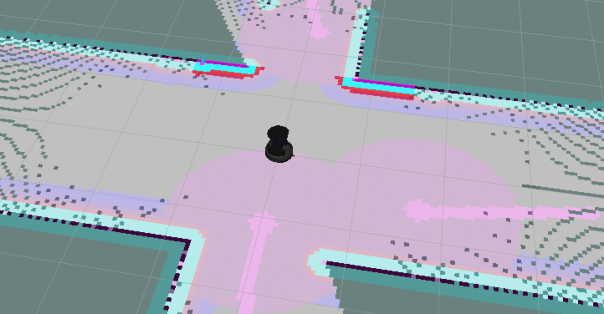
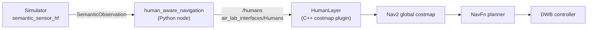
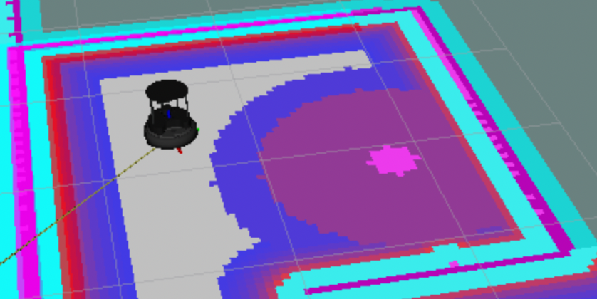
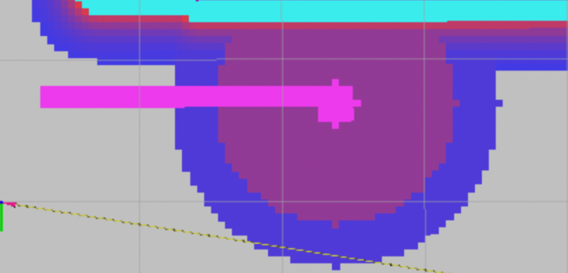

# Human-Aware Navigation for a TurtleBot (ROS 2 · Nav2)


This project adds a custom **Nav2 costmap layer** that gives a simulated TurtleBot a sense of personal space. Each detected person becomes a set of proxemic cost zones, and a person who is walking also gets a no-go corridor along their predicted path. The standard Nav2 planner then routes *around* people instead of brushing past them or cutting in front of them.

<p align="center">
  
  <br>
  <em>Global costmap in the <a href="https://gitlab.liu.se/tdde05_students/labs_instructions/-/wikis/project#running-the-simulator"><code>office_2</code></a> world. The large discs are personal-space zones around detected people, and the narrow stripes are their predicted paths.</em>
</p>

## Highlights

- **C++ Nav2 plugin** (`nav2_costmap_2d::Layer`, loaded through pluginlib). It paints proxemic zones and predicted paths into the global costmap.
- **Python ROS 2 node** that turns raw semantic detections into a tracked list of people in the `map` frame, using tf2.
- **Planner and controller unchanged**: everything goes through the costmap, so any Nav2 planner benefits from it.
- **Configured in YAML**: zone radii and costs, predicted-path length and width, and an on/off switch.

## How it works



1. **Perception node** (`human_aware_navigation`). The node subscribes to the simulator's semantic sensor and keeps only `human` observations. It transforms each one into the `map` frame with tf2, tracks people by UUID, and publishes the full list on `/humans` (UUID, position and timestamp for each person).
2. **`HumanLayer` costmap plugin**. On every costmap update it handles each person seen within the last second:
   - it paints concentric proxemic zones (intimate, personal and social) around the person;
   - if the person moved more than 0.1 m since the previous snapshot (taken every ~0.1 s), it estimates the direction of their velocity and paints a lethal corridor ahead of them in that direction.
3. **Nav2** plans on the resulting costmap with the stock NavFn planner and DWB controller.

| Zone | Size | Cost (0–254) | Effect on the planner |
|---|---|---|---|
| Intimate | 0.20 m radius | 254 (lethal) | Hard obstacle for the planner |
| Personal | 1.20 m radius | 127 | Avoided when a reasonable detour exists |
| Social | 3.60 m radius | 0 | Disabled in the current config |
| Predicted path | 2.0 m × 0.2 m, ahead of a walking person | 254 (lethal) | The robot does not cut in front |

<p align="center">
  
  
  <br>
  <em>Left: a standing person, with concentric zones. Right: a walking person, with a lethal corridor along the predicted path.</em>
</p>

## Repository layout

```
├── human_aware_navigation/           # Python node: semantic sensor → /humans
├── nav2_human_layer_costmap_plugin/  # C++ costmap layer + Nav2 config (nav2.yaml)
├── air_lab_interfaces/               # Human / Humans message definitions
├── air_lab_common/                   # RViz config and GNU screen launch configs
└── assets/                           # README images
```

## Context

This is my part of the group project ("an advanced office assistant") in [TDDE05 AI Robotics](https://www.ida.liu.se/~TDDE05/) at [Linköping University](https://liu.se/en), spring 2025. I designed and implemented the human-aware navigation. This code is intended to run in the TDDE05 course environment ([more details here](https://gitlab.liu.se/tdde05_students/labs_instructions/-/wikis/project)). The plugin skeleton follows the Nav2 tutorial [Writing a New Costmap2D Plugin](https://docs.nav2.org/plugin_tutorials/docs/writing_new_costmap2d_plugin.html).